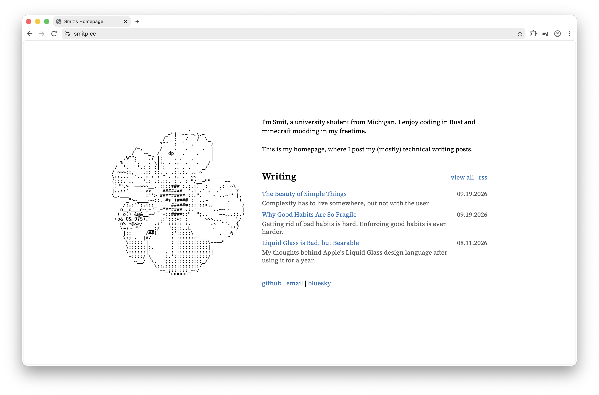

# smitp.cc
My current homepage.

The homepage switches between Writing and Last.fm using the section heading buttons.
Last.fm reads public listening activity for `smitsmusic`.
Set `extra.lastfm_api_key` in `zola.toml` to a [Last.fm API key](https://www.last.fm/api/account/create)
to enable the feed. This key is visible to visitors; never use the API secret.
Without a key or JavaScript, the Last.fm profile link remains available.
The feed refreshes once a minute while the page is visible.

Run its regression checks with `node tests/music.cjs` and `node tests/home-sections.cjs`.
