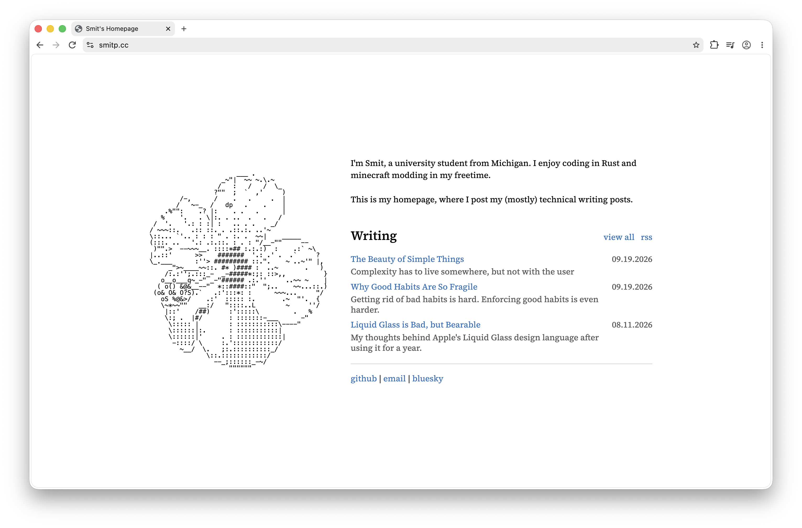

# smitp.cc
My current homepage.
[](https://smitp.cc/)

The homepage switches between Writing and Now using the section heading buttons.
Update the Now bullets in `templates/index.html` to share current priorities.
Without JavaScript, both sections remain visible.

Run the section-switching regression checks with `node tests/home-sections.cjs`.

Skyshot is served at `https://smitp.cc/skyshot/`. The Pages workflow checks for
updates to `smit4k/skyshot`'s `main` branch every hour and skips scheduled builds
when that commit is already live. Website pushes and manual runs also pick up
the latest Skyshot commit. The workflow builds and tests Skyshot before Zola
publishes the site. The live commit is recorded at `/skyshot/version.txt`.

To include Skyshot in a local preview, use the sibling `../skyshot` checkout with
its WebAssembly package built (see its README for prerequisites):

```sh
npm --prefix ../skyshot run build
mkdir -p static/skyshot
cp -R ../skyshot/dist/. static/skyshot/
zola serve
```

Open `http://127.0.0.1:1111/skyshot/`. The generated `static/skyshot/` directory is
ignored by version control and included in every Zola build or preview. Rebuild
and copy Skyshot again when its source changes. Run `zola build` followed by
`node tests/skyshot.mjs` to check the complete output.
